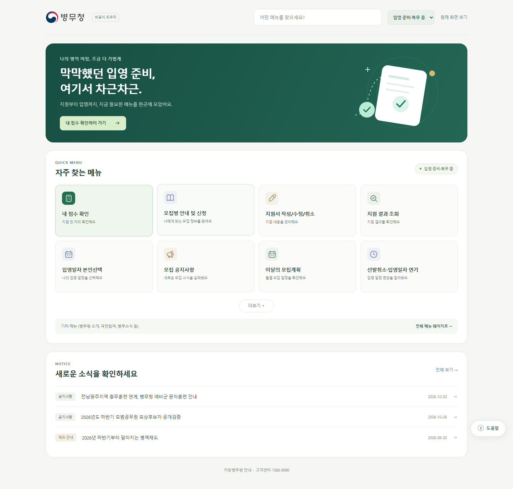
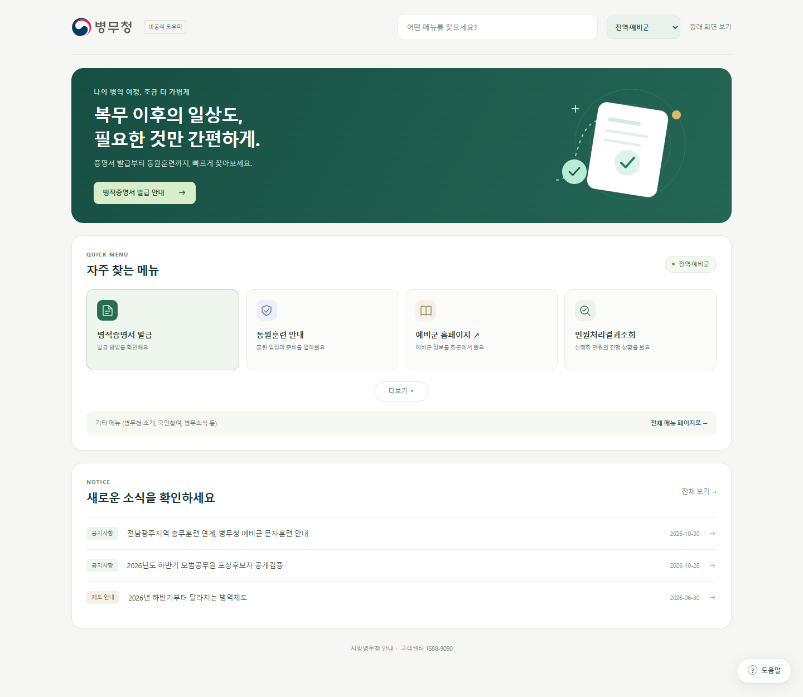
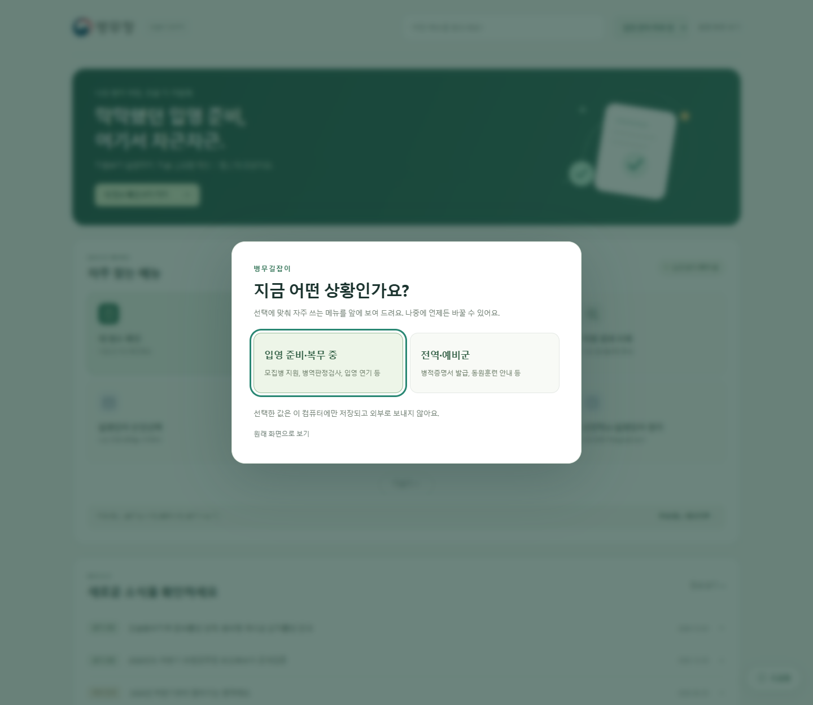
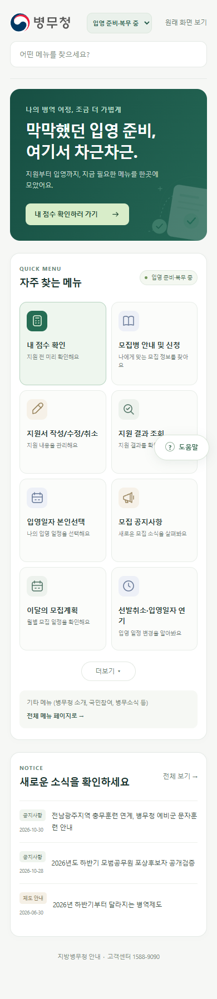

# 병무길잡이 메인 메뉴 프로토타입

병무청 누리집(`www.mma.go.kr`)의 메인 화면을 사용자 상황에 맞춘 화면으로 바꿔 주는 크롬 확장 프로그램 프로토타입입니다.
팀 와이어프레임(메인 화면 수정 1안)을 바탕으로 만들었습니다.

원본 페이지의 내용과 링크는 그대로 두고 그 위에 새 화면을 덮어씌우는 방식이라, 언제든 **원래 화면 보기**로 돌아갈 수 있습니다.

## 미리보기

| 메인 (입영 준비·복무 중) | 메인 (전역·예비군) |
|---|---|
|  |  |

| 첫 방문 상황 선택 | 모바일 화면 |
|---|---|
|  |  |

## 설치 및 실행

1. 크롬 주소창에 `chrome://extensions`를 입력합니다.
2. 오른쪽 위 **개발자 모드**를 켭니다.
3. **압축해제된 확장 프로그램을 로드합니다**를 누르고 이 `main_menu` 폴더를 선택합니다.
   이미 등록했다면 확장 프로그램 카드의 새로고침 버튼을 누릅니다.
4. <https://www.mma.go.kr/index.do>를 열거나 새로고침합니다.

## 주요 기능

### 메인 화면 (`main.js`, `main.css`)

- **상황 선택**: 처음 방문하면 상황 선택 창이 뜹니다. 선택은 상단 선택 상자에서 언제든 바꿀 수 있습니다.

  | 상황 | 주요 메뉴 | 더보기 메뉴 | 상단 버튼 |
  |---|---|---|---|
  | 입영 준비·복무 중 | 8개 (모집 공지사항·이달의 모집계획이 맨 앞) | 10개 | 이달의 모집계획 |
  | 전역·예비군 | 4개 | 6개 | 병적증명서 발급 안내 |

- **메뉴 검색**: 검색창에 입력하면 원본 페이지에서 모은 전체 메뉴에서 찾아 줍니다.
- **전체 메뉴**: 원본의 대메뉴 5개(병역이행안내, 군지원(입영신청)안내, 국민참여마당, 병무소식, 병무청소개)와 병무민원 바로가기를 원래 구조대로 보여 줍니다.
- **최근 소식**: 원본 메인의 공지사항 2건과 달라지는 제도 1건을 보여 줍니다.
- **내 정보 패널**: 오른쪽 아래 **내 정보** 버튼으로 엽니다(기본은 접힘).
  - 나의 상황 확인 및 변경
  - 입영(예정)일 또는 전역일 입력 시 D-day 표시
  - 관심 특기 입력 시 모집 공지 바로가기 표시
- **원래 화면 보기**: 원본 화면으로 돌아가며, 화면 아래 버튼으로 다시 병무길잡이 화면을 열 수 있습니다.

### 기존 기능 (`content.js`)

- **공지사항 정리**: 육군·해군·공군·해병대·취업맞춤특기병 모집 공지 목록을 카드 형태로 바꾸고, 잘린 제목 복원·중복 고정공지 제거·분야별 필터·NEW 표시를 제공합니다.
- **점수 확인 자동 입력**: 군지원 서비스의 「내 점수 미리 알아보기」 추가항목(신체조건) 값을 저장해 두었다가 다음 방문 때 자동으로 채웁니다. "다음" 버튼은 누르지 않으며 제출은 사용자가 직접 합니다.
- **테스트 패널**: 메인 화면이 아닌 병무청 페이지에서 확장 프로그램이 동작 중인지 보여 주는 작은 패널을 띄웁니다.

## 메뉴 연결 방식

- 메뉴는 원본 페이지 링크의 주소와 `target`을 그대로 쓰는 실제 `<a>` 링크입니다. 새 탭 열기, 오른쪽 클릭, 주소 미리보기가 모두 됩니다.
- 이름이 겹치는 메뉴(FAQ, 공지사항 등)는 `중메뉴 > 소메뉴` 경로로 찾습니다. 별칭은 `main.js`의 `aliases`에 정의되어 있습니다.
- `내 점수 확인`과 `지원 결과 조회`는 원본 메인에 직접 링크가 없으면 군지원 서비스로 연결합니다. 이 경우 서비스 안에서 해당 메뉴를 다시 선택해야 합니다.
- 원본에서 찾지 못한 메뉴는 콘솔에 경고를 남기고 전체 메뉴 검색으로 안내합니다.
- 메뉴 개수는 실제 누리집을 기준으로 계산하므로 와이어프레임에 적힌 개수와 다를 수 있습니다.

## 저장하는 정보

모든 값은 `chrome.storage.local`(사용자 컴퓨터)에만 저장하며 외부로 보내지 않습니다.

| 키 | 내용 |
|---|---|
| `bmgj_main_audience` | 선택한 상황 (`ready` / `reserve`) |
| `bmgj_profile` | 내 정보 패널 값 (입영(예정)일, 전역일, 관심 특기) |
| `cghm_profile` | 점수 확인 추가항목 입력값 |

## 파일 구성

| 파일 | 역할 |
|---|---|
| `manifest.json` | 확장 프로그램 설정 (Manifest V3), 대상 사이트와 스크립트 등록 |
| `main.js` | 메인 화면, 상황 선택, 메뉴 검색, 전체 메뉴, 내 정보 패널, 원본 화면 전환 |
| `main.css` | 메인 화면 스타일과 작은 화면 대응 |
| `content.js` | 공지사항 정리, 점수 확인 자동 입력, 테스트 패널 |
| `previews/` | 화면 미리보기 이미지 |

## 확인한 범위와 남은 작업

- **확인함**: 실제 메인 HTML로 메뉴 개수, 더보기, 전체 메뉴 분류, 원본 화면 복귀, 작은 화면에서 가로 넘침 여부, 자바스크립트 오류를 확인했습니다.
- **확인 필요**: 확장 프로그램을 실제로 등록한 상태에서의 자동 입력, 로그인 이후 화면에서의 동작.
